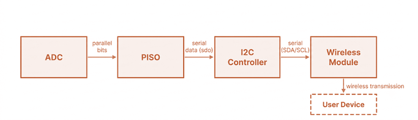
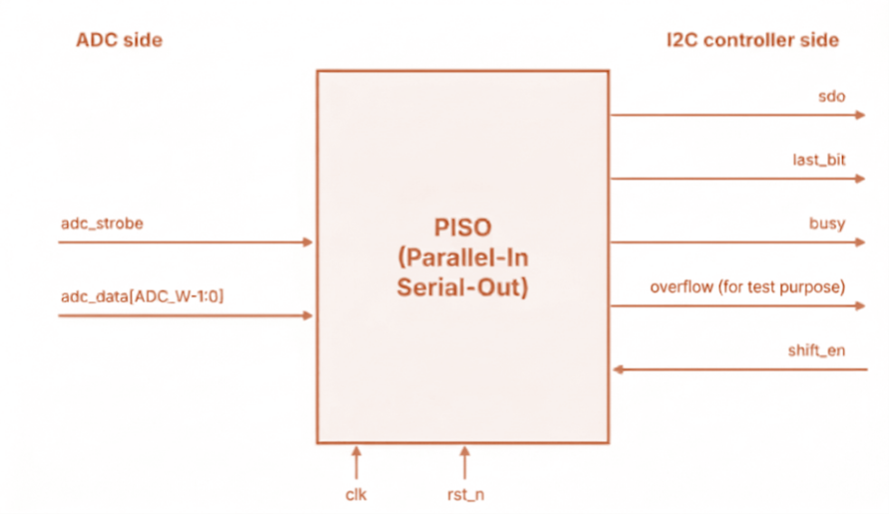
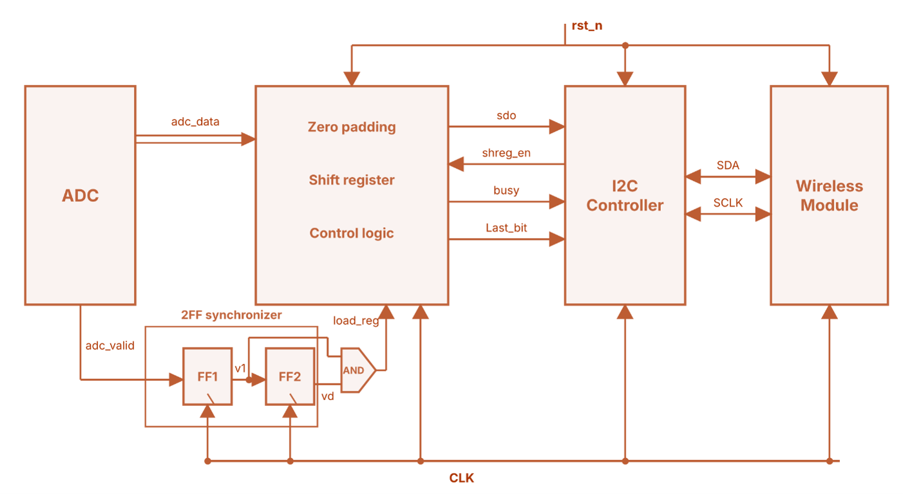
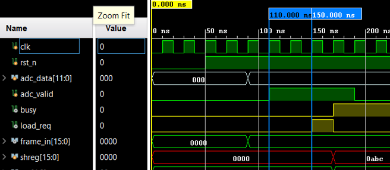
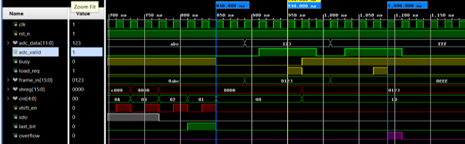
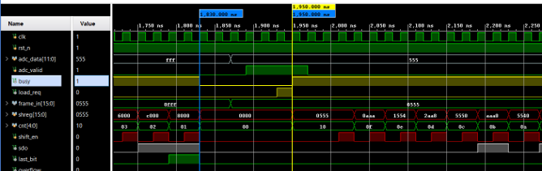
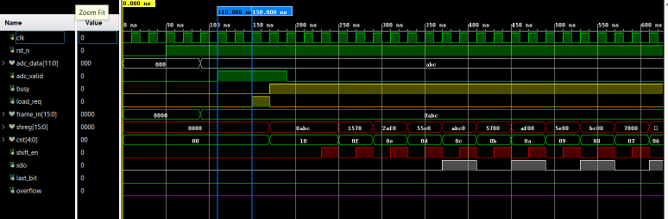
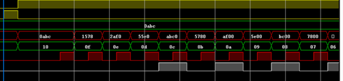

# 1. Project Statement

Following the ADC, the digitised samples must be delivered to an external user device. For this, I choose the following architecture: the parallel ADC output is captured by a Parallel-In Serial-Out (PISO) register, serialised, and passed to an I2C controller, which transfers the data to a wireless module that transmits it to the user device.

# 2. System Block Diagram

- ADC produces parallel data bits together with a strobe signal that marks each new sample.
- The PISO converts this parallel word into a serial bit stream.
- The I2C controller sends the serial data to the wireless module over the SDA/SCL lines.
- The wireless module transmits it to the user device.

# 3. PISO (Parallel-In Serial-Out) Module

## 3.1 Interface

Figure 2 shows the PISO as a single block. The ADC side provides the clock, reset, strobe and parallel data. The I2C side exchanges the serial output and the handshake signals.

]
| Signal | Direction | Function |
|---|---|---|
| `clk` | Input | System clock; |
| `rst_n` | Input | Reset |
| `adc_strobe` | Input | Asynchronous strobe from the ADC, marking that a new sample is valid |
| `adc_data[ADC_W-1:0]` | Input | Parallel ADC output data |
| `sdo` | Output | Serial data out; always the MSB of the shift register |
| `last_bit` | Output | Goes high when the bit on sdo is the last bit of the frame |
| `busy` | Output | High while a frame is being transmitted; new samples are rejected |
| `overflow` | Output | One-clock pulse when a sample arrives while busy and is rejected |
| `shift_en` | Input | One-clock pulse from the I2C controller requesting the next bit |

## 3.2 Configurable bits

The PISO is parameterised so that it can follow the ADC resolution without any change to the architecture.

- FRAME_W : Frame width in bits after zero padding; a multiple of 8 so the frame is sent as whole I2C bytes (maximum capacity) = total FF in shift register.
- If ADC bits are less than FRAME_W they are zero padded to FRAME_W.

The frame is sent as FRAME_W/8 bytes, each followed by one ACK/NACK clock.

## 3.3 Architecture

It consists of the 2-FF synchronizer with a rising-edge detector, the zero-padding stage, the shift register and the control logic.

<!-- TODO (image fix): in Figure 3, (1) relabel "shreg_en" -> "shift_en" and "load_reg" -> "load_req"; (2) add a third flip-flop FF3 after FF2 and label the outputs v0 (FF1), v1 (FF2), v_d (FF3); the AND gate takes v1 and NOT v_d, and only FF1 and FF2 sit inside the "2FF synchronizer" box. -->

- **Synchronizer and load_req logic.** The asynchronous adc_strobe passes through two flip-flops (FF1 and FF2) clocked by the system clock, which form the 2-FF synchronizer. Their outputs are v0 (FF1) and v1 (FF2).
  - A third flip-flop (FF3) stores the previous value of v1 as v_d. The rising-edge detector is `load_req = v1 & ~v_d`, so load_req is high for exactly one system clock cycle for each rising edge of the strobe.
- **Shift register.** The shift register holds the zero-padded frame of FRAME_W bits. It loads the frame when the control logic issues a load_req, and shifts left by one bit on each shift_en pulse (drives by I2C). Its MSB drives sdo.
- **Control logic.** It decides whether a load request is accepted, and maintains the busy flag, the bit counter cnt, the overflow flag and the last_bit flag.

## 3.4 Synchronizer purpose

**Problem without synchronizer** : The ADC strobe is generated by the ADC and its clock, which is not related to the system clock of the PISO and I2C Controller. The strobe can therefore change at any instant relative to the system clock edge.

- If an asynchronous signal changes close to the clock edge, the first flip-flop may violate its setup or hold time and enter a metastable state, where its output is neither a clean 0 nor a clean 1 for some time.
- A metastable value reaching the control logic directly can be read differently by different parts of the logic, which can cause a missed sample, a false load, or a corrupted frame.

**With synchronizer**

- Using two flip-flops in series gives the first flip-flop one full clock period to settle before the second samples it. The probability that metastability reaches the logic is then greatly reduced.
- The synchronized strobe is then passed through the rising-edge detector (built from v1 and its delayed copy v_d from FF3), which converts the strobe (whose width may be longer or shorter than a system clock period) into a clean single-cycle load_req.

## 3.5 Data flow sequence

**Loading the ADC data into the PISO : (implemented)**

1. The ADC output adc_data is zero-padded up to FRAME_W (max capacity of shift registers) bits.
2. adc_strobe is synchronized to the system clock by the 2-FF synchronizer and passed to the rising-edge detector, which produces load_req as a single-cycle pulse.
3. If the PISO is idle (busy = 0) & load_req = 1 : the zero-padded sample frame is loaded into the shift register, cnt is set to FRAME_W and busy goes high.
4. If the PISO is busy (busy = 1): the incoming ADC sample is ignored, and overflow goes high for one clock cycle to flag the rejection.
5. When shift_en = 1: update the counter and shift the shift register by 1 to left, new MSB goes on sdo (ready for serial transmission).

**Serial transfer to the wireless module through the I2C controller : (not implemented)**

1. After loading, the PISO is busy and keeps the MSB of the frame on sdo.
2. The I2C controller sends the start condition and the slave address of the wireless module, then sends the data one byte (8 bits) at a time on SDA.
3. While SCL is low, the I2C controller reads the bit on sdo and drives it onto SDA. SDA is held stable while SCL is high, when the wireless module (slave) samples it.
4. In the following SCL-low half cycle, the I2C controller sends a one-clock pulse on shift_en. On shift_en, the PISO shifts the register left by one bit, so the next bit appears on sdo: `shreg <= {shreg[FRAME_W-2:0], 1'b0}`.
5. Steps 3 and 4 repeat for the 8 bits of the byte.
6. On the 9th clock, the I2C controller does not pulse shift_en. sdo holds its state while the wireless module (slave) sends ACK or NACK. The same process repeats for the next byte.
7. When cnt reaches 1, the PISO raises last_bit, marking that the bit currently on sdo is the last bit of the frame. last_bit stays high only while that bit is on sdo and goes low once it is shifted out, so the I2C controller must remember that it saw last_bit.
8. After the I2C controller reads this last bit and pulses shift_en, busy drops to 0 and the PISO is free to accept the next ADC sample.
9. The I2C controller completes the ACK/NACK clock of the last byte and then generates the STOP condition.

## 3.6 PISO Test Results

**Test 1** : Verifying the Load_req and loading of the new sample into shift registers

**Test 2** : Checking overflow condition, new sample is dropped when PISO is busy

**Test 3** : Checking after first sample, PISO goes to Idle and accepts new sample

**Test 4** : Verifying that counter updated and shift register left shift by 1 bit when shift_en goes high (by I2C)

Zoomed Version

# 4. Future Work

- Implementation of the I2C controller to transmit the serial data to wireless module.
- Design and implementation of the Wireless Module to transmit the received serial data to user device (Bluetooth / Wi-Fi).
- Functional Verification of overall system.